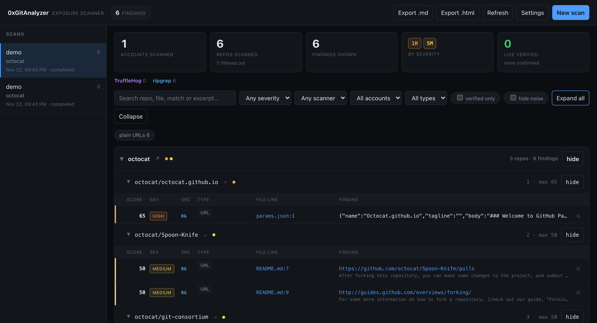
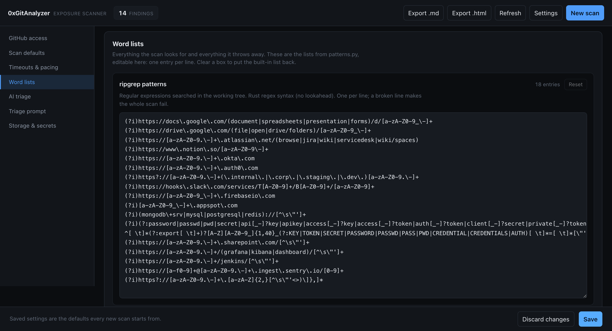

# 0xGitAnalyzer

**Open-source GitHub exposure scanner.** Give it a list of accounts. It clones every
public repository those accounts own, scans the full git history for credentials and
the working tree for internal infrastructure, scores what it finds, and shows you the
result in a local dashboard.



```bash
gitanalyzer scan accounts.txt --keywords "acme,acmecorp.com"
gitanalyzer serve
```

---

## Why this exists

The cost of scanning an organization's entire public footprint used to be the defense.
Cloning a few thousand repositories, grepping them, and reading the output took a
person weeks, so most of that exposure simply sat there, technically public and
practically invisible.

That cost is gone. An attacker with a laptop, a scanner and an LLM to triage the
output now does in an afternoon what used to take a quarter — and the expensive part
was never finding the matches, it was deciding which twenty of the ten thousand were
real. Models are good at exactly that.

So the asymmetry flipped: whoever is scanning your company from the outside already has
this. The point of releasing it is that your security team should be able to run the
same thing against your own footprint first, on your own machine, with code you can
read.

**Run it against yourself before someone else does.**

---

## What it looks for

Two scanners, with deliberately separate jobs:

| Scanner | Looks for | Why it is here |
|---|---|---|
| **TruffleHog** | Credentials, across the **full git history** — 800+ detector types, with live verification where the provider allows it | A secret deleted in a later commit is still in the history, and still works |
| **ripgrep** | What TruffleHog ignores: internal hostnames, Google Docs and Drive links, Jira/Confluence, Okta/Auth0, SharePoint, Slack webhooks, dashboards, CI, database URLs, and hardcoded config values in both quoted (`api_key: "..."`) and bare dotenv (`INTERNAL_API_TOKEN=...`) form | This is how an outsider maps your company before touching a single credential |

0xGitAnalyzer does not reimplement either one. A half-finished regex engine that misses
real keys is worse than no scanner.

### The part that matters: filtering

Raw scanner output is useless at this scale — a few dozen accounts produce thousands
of matches, nearly all of them placeholders, test fixtures and documentation. Every
finding is scored 0-100 by [`scoring.py`](gitanalyzer/scoring.py):

- **Up:** live-verified credentials, `.env`/config files, private keys outside test
  paths, `AKIA...`, credential URLs, internal and corporate hostnames, credential
  stores (`rclone.conf`, `.npmrc`, `.netrc`), AI devtool configs (`CLAUDE.md`,
  `.cursor/`, `mcp.json` — a new and very productive class of leak)
- **Down:** placeholders, elided values (`sk-ant-...`), references to a secret rather
  than the secret (`API_KEY=os.environ["X"]`), public demo keys, `test/`, `example/`,
  `fixture/`, blog posts and CTF write-ups, vendored `forge-std`, minified bundles,
  low-value detectors (Discord webhooks, Pixabay keys)

Findings land in four buckets — `secret`, `keyword match`, `infrastructure`, `plain
URL`. The dashboard shows all of them by default; the chip row above the results
filters by bucket (click one to isolate it, ctrl/cmd-click to add another), and a
**hide noise** toggle drops plain URLs, informative findings and confident AI
dismissals in one go. Secrets and keyword matches are never dropped by the per-repo cap.

Severity bands are `critical` (80+), `high` (60+), `medium` (40+), `low` (20+) and
**`informative`** below that. The bottom band is deliberately not called low: in a
bounty programme "low" means reportable-but-minor, while `informative` means this is
not a vulnerability at all — a public marketing URL, a docs link, anything AI triage
confidently dismissed. Informative findings stay out of the default dashboard view and
out of the markdown report, though the dashboard shows them until you ask it not to.

All of it is plain data in [`patterns.py`](gitanalyzer/patterns.py), and all of it is
editable from **Settings → Word lists** without touching the file. Tune it for your own
organization; that is the point of it being open source.

---

## Install

Requires **Python 3.9+**, plus three external tools:

```bash
# macOS
brew install git ripgrep trufflehog

# Debian/Ubuntu
sudo apt install git ripgrep
curl -sSfL https://raw.githubusercontent.com/trufflesecurity/trufflehog/main/scripts/install.sh | sh -s -- -b /usr/local/bin
```

Then:

```bash
git clone https://github.com/OliveXSecurity/0xGitAnalyzer
cd 0xGitAnalyzer
pip install -e .            # or: pip install -e ".[ai]" for AI triage

gitanalyzer doctor          # verify everything is wired up
```

Both `gitanalyzer` and `0xgitanalyzer` start the same CLI.

`doctor` prints what it found and exits non-zero if a required tool is missing:

```
[ok  ] git         git version 2.39.5
[ok  ] rg          ripgrep 15.2.0
[ok  ] trufflehog  trufflehog 3.99.9
[WARN] github      no GITHUB_TOKEN — limited to 60 requests/hour
[ -- ] ai triage   disabled (no ANTHROPIC_API_KEY)
```

0xGitAnalyzer itself has **no Python dependencies**. The only optional one is the
Anthropic SDK, for AI triage.

### GitHub token

Without one you get 60 API requests per hour, which is not enough for a real run.
With one, 5000.

```bash
export GITHUB_TOKEN=ghp_...
```

A token with **no scopes at all** is enough — this tool only reads public data.

You can also paste it into the dashboard (**Settings → GitHub**) instead of exporting
it. A token saved that way is stored in `results/.settings.json` with mode `0600`; the
API only ever returns a masked hint of it, and **it is never written into a scan file**,
so a report you hand to a client cannot carry it. If you would rather keep secrets out
of files entirely, leave the field empty and use the environment variable.

---

## Use

### As a CLI

```bash
# one account
gitanalyzer scan octocat

# a list, with your company's keywords flagged
gitanalyzer scan accounts.txt --keywords "acme,acme-internal,acmecorp.com"

# everyone who is a public member of an org
gitanalyzer scan --org acme-corp --keywords "acme,acmecorp.com"

# see what a run would do, without running it
gitanalyzer scan accounts.txt --dry-run

# list what you have already scanned
gitanalyzer list

# hand a client a single self-contained HTML file
gitanalyzer report <scan-id> --format html -o acme-exposure.html

# throw a scan away (asks first; -y skips the question)
gitanalyzer delete <scan-id> [<scan-id> ...]
```

`accounts.txt` takes one login or profile URL per line; `#` comments are ignored.
See [`examples/accounts.txt`](examples/accounts.txt).

The CLI keeps tuned filters by default — 24 months, 500 MB, a 7-day cooldown and 200
findings per repo — because there the values are typed, listed in `--help` and printed
in the run header. Pass `0` to any of them to turn that limit off; the dashboard starts
with all four at 0.

### As a dashboard

```bash
gitanalyzer serve                 # http://127.0.0.1:8711
```

The dashboard groups findings by account → repository → finding, with search,
severity/scanner/type/keyword filters, deep links to the exact line on GitHub, and
per-account hiding for noise you have already dismissed. It also starts scans: the
**New scan** button takes an account list and the common options, and results stream
in while repositories are still being cloned. Hovering a scan in the sidebar reveals a
delete button: a scan file holds the only copy of its findings — the clones it read are
temporary — so it asks before removing one, and refuses while the scan is still running.

It is the same page the HTML export produces — the only difference is whether the data
comes from the local API or is embedded in the file.

```
GET    /                        the dashboard
GET    /api/scans               scan summaries
GET    /api/scans/<id>          one scan, findings included
GET    /api/scans/<id>/report.html|report.md
GET    /api/status              tools, token and AI readiness
GET    /api/settings            stored defaults (secrets masked)
GET    /api/patterns            every pattern, glob and word list a scan uses
POST   /api/settings            update defaults
POST   /api/ai/models           ask an endpoint for its model list
POST   /api/scan                start a scan
POST   /api/scans/<id>/cancel   stop a running scan
DELETE /api/scans/<id>          delete a scan file
```

### Settings

Everything the CLI takes as a flag is also editable in the dashboard under
**Settings** — a full page, not a dialog, because it holds eight editable word lists
and a system prompt. Saved values become the defaults every new scan starts from:

- **GitHub access** — the token, plus a live view of how many requests you have left
- **Scan defaults** — keywords, extra literal patterns, repo age, size, cooldown,
  per-repo cap, forks/archived, and which of the two scanners run. Every limit here
  takes **0 as "no limit"**, and that is what the dashboard ships with: a filter you
  never set should not be the reason a scan comes back empty. Each field explains
  itself on hover, in the panel and in the New scan dialog alike
- **Timeouts & pacing** — clone depth, every timeout, and the delays between
  repositories and accounts
- **Word lists** — every list in `patterns.py`, editable in place: the 18 ripgrep
  patterns, the 53 include and 45 exclude globs, the three placeholder vocabularies and
  the two detector scoring tiers. A box marks itself *custom* when it stops matching the
  built-in list, **Reset** puts that list back, and clearing a box means the same thing:
  only the lists you actually changed are stored, so the rest keep tracking the ones
  that ship with the tool
- **Triage prompt** — the system prompt itself, which you can read, edit or reset
- **AI triage** — provider, endpoint, model, API key, redaction, batch size, timeouts
- **Storage & secrets** — where scans, settings and cloned code go, and what leaves
  the machine



A ripgrep pattern is validated by ripgrep itself before it is saved: Rust's regex
engine has no look-around, so a pattern Python would accept is rejected here rather
than silently matching nothing on the next scan. If one still fails at scan time, the
scan log says so instead of reporting a clean repository.

Every field of `ScanConfig` is reachable from this panel; a test asserts it, so a new
flag cannot be added to the CLI and quietly skipped in the UI.

The dashboard tells you when something would quietly degrade a run: a missing tool, no
GitHub token (60 requests/hour), a token GitHub rejects, or AI triage switched on with
no key behind it.

The server binds to `127.0.0.1`, rejects non-loopback `Host` headers (DNS rebinding),
and has **no authentication** — scan results contain credential material, so do not
expose it. Use an SSH tunnel if you need it from elsewhere.

### Useful flags

`--results DIR` works on either side of the subcommand (`gitanalyzer --results X serve`
and `gitanalyzer serve --results X` are the same thing). Everything else is per-scan:

| Flag | Default | What it does |
|---|---|---|
| `--keywords` | — | Comma-separated terms (company name, domains). Matches are promoted and never capped |
| `--max-age MONTHS` | 24 | Skip repos not pushed in that long |
| `--max-size MB` | 500 | Skip oversized repos |
| `--cooldown DAYS` | 7 | Skip accounts scanned recently. `0` disables |
| `--cap N` | 200 | Max findings per repo. Secrets and keyword hits are exempt. `0` = unlimited |
| `--include-forks` / `--include-archived` | off | Scan them too (much slower, rarely worth it) |
| `--pattern-file FILE` | — | Extra literal strings to search for (internal project names, hostnames) |
| `--depth N` | 0 | Shallow clone. **Only with `--no-trufflehog`** — history scanning needs full history |
| `--no-trufflehog` / `--no-ripgrep` | off | Run only one of the two scanners |
| `--label NAME` | — | Short name for the scan, shown in the dashboard |
| `--html` / `--md` | — | Also write a report when the scan ends |
| `--dry-run` | off | Print the resolved config and exit |

### Optional: AI triage

```bash
export ANTHROPIC_API_KEY=...
pip install -e ".[ai]"
gitanalyzer scan accounts.txt --keywords "acme" --ai-triage
```

The prompt is in [`triage.py`](gitanalyzer/triage.py) as `SYSTEM_PROMPT`, and is
overridable per installation from **Settings → AI triage → Triage prompt**. Whatever you
write has to keep asking for the same JSON array, or the verdicts cannot be parsed and
the batch is ignored — the heuristic scores survive either way.

Off by default. When enabled, the top findings are reviewed by a model and labelled
`true_positive` / `needs_review` / `false_positive`, with a one-line reason. A confident
dismissal drops out of the default view; a confirmation is promoted. **Heuristic scores
are kept alongside**, so you can always see where the two signals disagree — the model
re-ranks the queue, it does not get to delete anything.

**Credential values are masked before they leave your machine** (`--ai-redact`, on by
default — see [`triage.py`](gitanalyzer/triage.py) for exactly what is sent).
`--ai-no-redact` turns that off; read the function before you use it on client data.
Triage never fails a scan: a batch that errors or is declined leaves the heuristic
scores untouched.

#### Any provider

Two wire formats are supported, and the right one is inferred from the URL:

| Provider | Flags |
|---|---|
| Anthropic (default) | `ANTHROPIC_API_KEY`, nothing else |
| Kimi / Moonshot | `--ai-base-url https://api.moonshot.ai/anthropic --ai-model kimi-k2-...` |
| DeepSeek | `--ai-base-url https://api.deepseek.com/v1 --ai-model deepseek-chat` |
| OpenRouter, Groq, Together | `--ai-base-url <their /v1> --ai-model <id>` |
| Ollama / vLLM / LM Studio (local) | `--ai-base-url http://localhost:11434/v1 --ai-model <id>` |

Pick one in **Settings → AI triage** and the endpoint and wire format fill themselves
in; for an OpenAI-format endpoint, **Load from endpoint** asks it for its own model list
rather than trusting a hardcoded one. Or use the flags below.

The `openai` format is plain stdlib `urllib` — **no SDK, no dependency at all**. Only
the Anthropic format needs `pip install -e ".[ai]"`. Anthropic-specific request options
(`output_config`, the server-side refusal fallback) are sent *only* to Anthropic's own
endpoint, because a compatible third-party endpoint answers `400` to them.

`gitanalyzer doctor` prints the endpoint, format and key variable it resolved.

| Flag | Default |
|---|---|
| `--ai-model` | `claude-opus-5-5` |
| `--ai-base-url URL` | — (Anthropic) |
| `--ai-api {anthropic,openai}` | inferred from the URL |
| `--ai-key-env NAME` | `ANTHROPIC_API_KEY` or `OPENAI_API_KEY` |
| `--ai-max N` | 150 findings |
| `--ai-no-redact` | off (values are masked) |

---

## Output

Scans are written to `results/scan-<id>.json` as they run — partial results appear in
the dashboard while repositories are still being cloned. Cloned code is deleted as
soon as it has been scanned; only the JSON stays.

```
results/
  scan-20261121-214046-0001ff17.json   one scan, everything in it
  .history.json                        last-scanned timestamps, for --cooldown
  .settings.json                       dashboard defaults — mode 0600, may hold tokens
```

Scan files contain credential material. `results/` is in `.gitignore`. Keep it that
way.

---

## Scope and limits

- **Public repositories only.** No authentication games, no private data, no GitHub
  code-search API. Everything it reads, anyone can read.
- **Read-only.** It clones and greps. It never writes to a repository, opens an issue,
  or contacts a discovered service. Verification of credentials is TruffleHog's, and it
  only touches the credential's own provider.
- It will not find secrets in repos that are private, in packages, or in CI logs. This
  is one surface, not an audit.

### Authorization

Only scan accounts you are authorized to assess: your own organization, a bug bounty
program whose scope covers it, or a client engagement you have in writing. Public does
not mean fair game, and this tool makes it easy to do a lot of it quickly.

---

## Architecture

```
gitanalyzer/
  cli.py        argparse front end
  scanner.py    the pipeline: repos -> filter -> clone -> scan -> score -> cap -> flush
  github.py     GitHub REST client (stdlib urllib, no requests)
  scanners.py   TruffleHog and ripgrep wrappers
  patterns.py   what to look for, what to ignore          <- tune this
  scoring.py    0-100 confidence, severity, type, category <- and this
  triage.py     optional LLM review
  store.py      one JSON file per scan, atomic writes
  settings.py   dashboard settings; keeps tokens out of scan files
  server.py     local dashboard + JSON API
  report.py     self-contained HTML / markdown export
  web/          the dashboard (no build step, no npm)
tests/          unittest, standard library only
```

---

## Development

```bash
pip install -e ".[ai]"
gitanalyzer doctor

python -m unittest discover -s tests -v    # needs git and ripgrep on PATH
python -m compileall gitanalyzer
```

The tests cover the parts where a regression is silent: the placeholder heuristics,
scoring and the per-repo cap, account parsing, store atomicity and path handling,
report rendering, and a full clone-scan-score pass against a git repository created
on the fly. No network, no GitHub token.

## Contributing

Pattern and scoring improvements are the most useful contributions: if a rule produces
noise for your stack, a PR that fixes it helps everyone. See
[CONTRIBUTING.md](CONTRIBUTING.md).

## Reporting a vulnerability in the tool

Privately, through the repository's **Security → Report a vulnerability**, never as a
public issue. [SECURITY.md](SECURITY.md) says what is in scope — command and argument
injection into `git`/`rg`/`trufflehog`, path traversal out of the results directory,
a stored token reaching a scan file or an export, XSS from a scanned repository's own
content, and a scan that fails open while still reporting "completed" — and what is a
documented property instead, starting with the dashboard having no authentication.

## License

MIT. See [LICENSE](LICENSE).

---

0xGitAnalyzer is developed by [OliveX Security](https://www.olivex.io).
